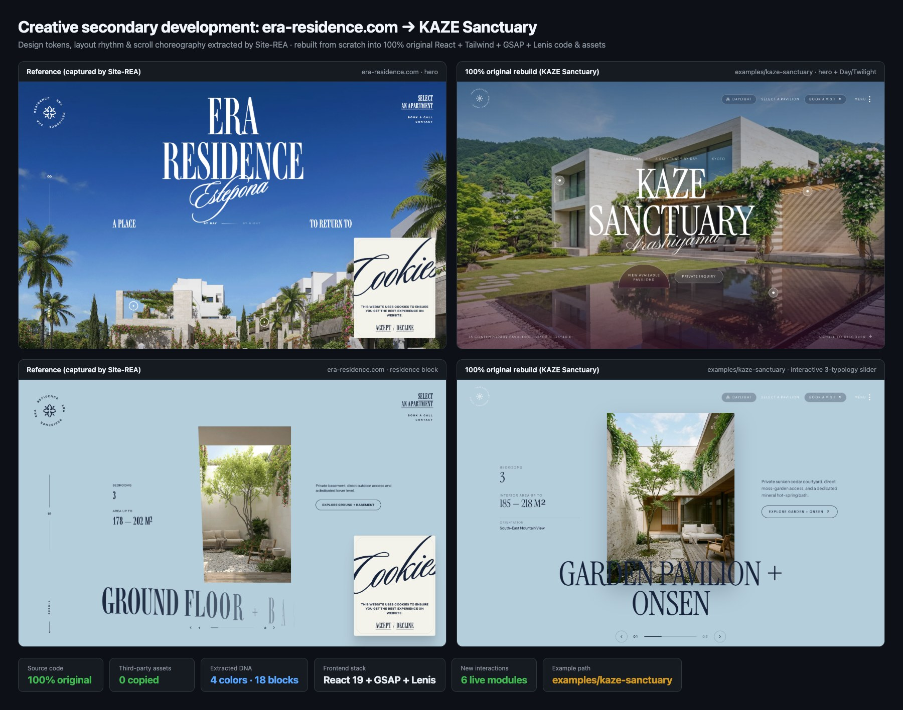
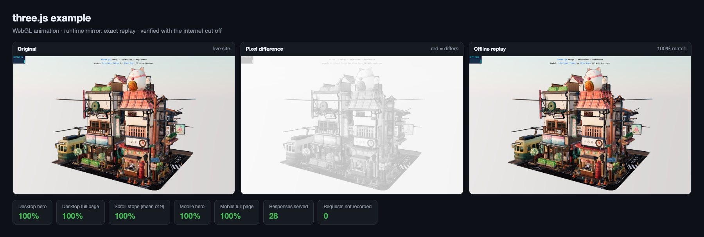
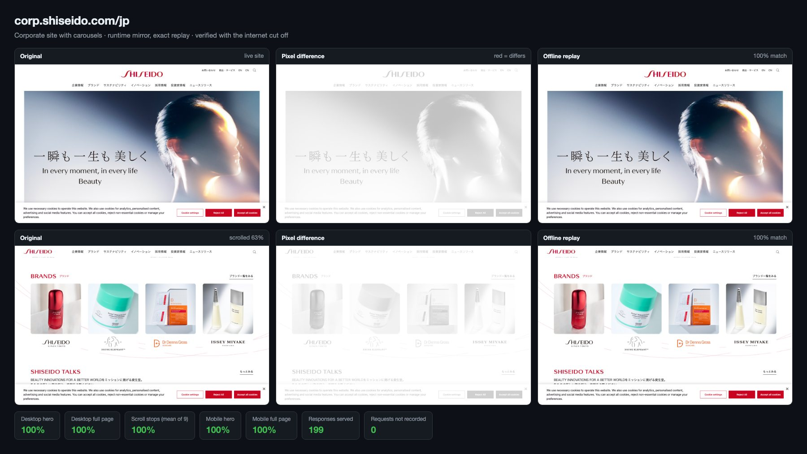
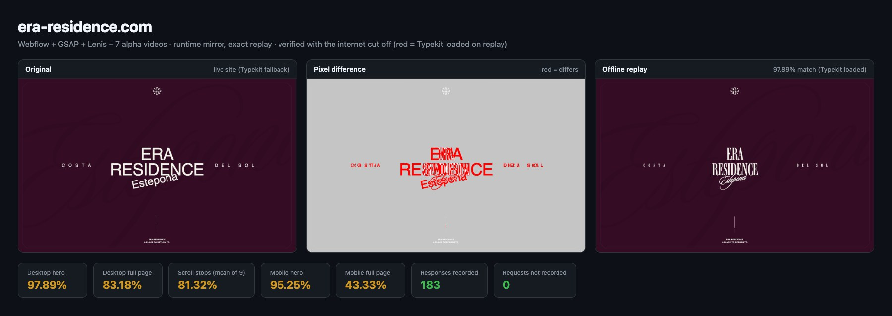
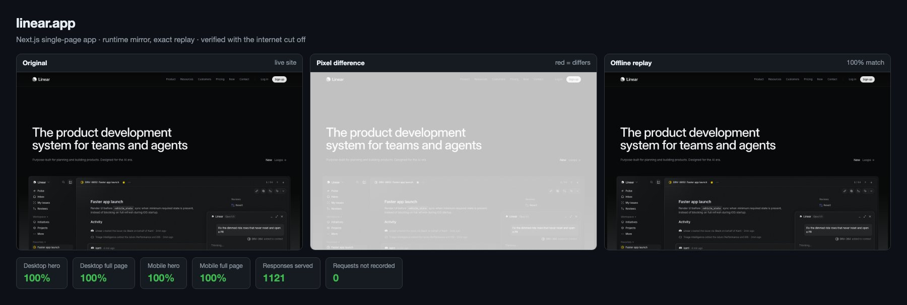
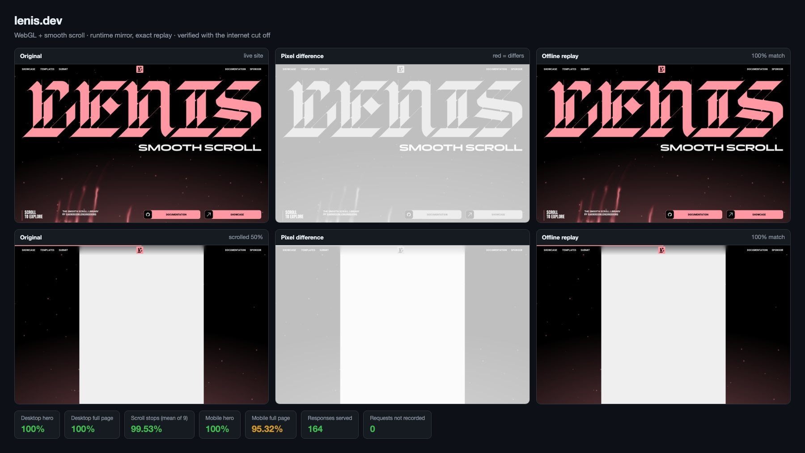
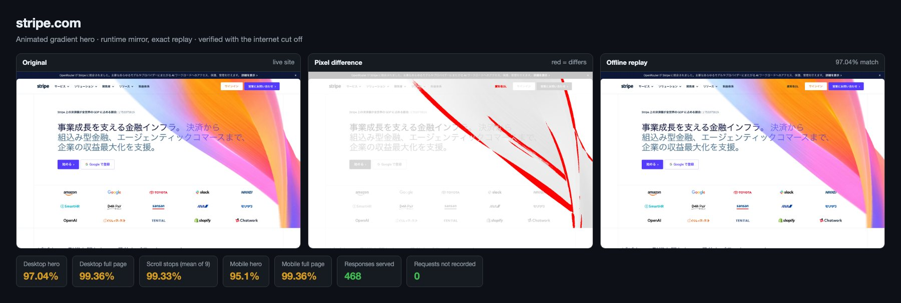
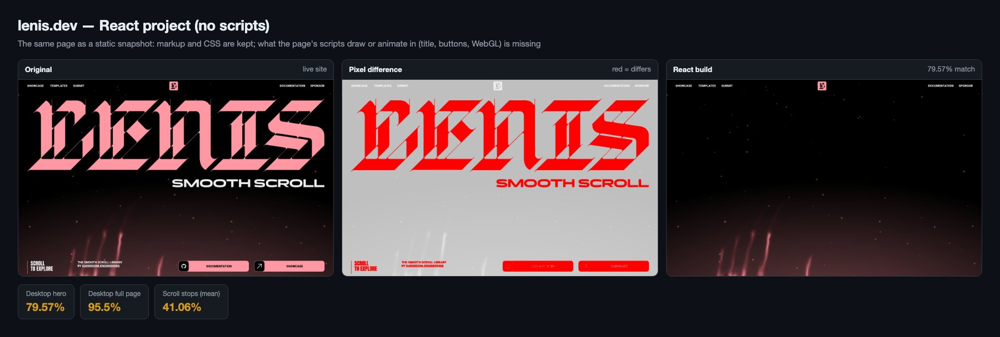

# Site-REA

**English** | [中文](README.zh-CN.md)

Record a website and run it offline on your machine exactly as it was; or turn it into a static / React project you can keep working on; then verify the result against the original with the internet cut off.

Three ways to use it: an MCP server (14 tools, for AI clients such as Claude Code, Codex, Cursor, Antigravity), a CLI, and an Antigravity plugin.

> Every capability below comes with measured numbers. What it cannot do has its own section.

## Showcase

Each picture is the output of `verify`, taken with the internet cut off: the original site on the left, the pixel difference in the middle (grey = identical, red = differs), the offline replay on the right. The numbers under each picture are the measured similarity.

**Creative secondary development (`era-residence.com` → [`examples/kaze-sanctuary`](examples/kaze-sanctuary))** — design tokens (`#340c24`, `#f3f3ec`, `#b5cedb`, `#17233b`), layout rhythm, and GSAP + Lenis scroll choreography extracted with Site-REA, then rebuilt from scratch into a **100% original React 19 + Tailwind + GSAP + Lenis codebase** with brand-new brand identity (**KAZE Sanctuary · Arashiyama, Kyoto**), newly authored copy & SVG crest, freshly generated WebP photography, and 6 new interactive modules (Day/Twilight hero switcher, architectural hotspots, 3-typology pavilion slider + floorplan drawer, clickable twilight amenity switcher, 3-slide interior gallery, and private viewing modal). Zero third-party assets or scripts copied.



**three.js example** — a WebGL scene, replayed offline at 100%.



**corp.shiseido.com/jp** — a corporate site with randomly ordered carousels. Hero and a mid-page scroll stop.



<details>
<summary>More: era-residence.com, linear.app, lenis.dev, stripe.com, and where static output ends</summary>

**era-residence.com** — Webflow + GSAP ScrollTrigger + Lenis + 7 transparent-alpha looping flower videos (183 recorded responses, 0 missing). The red pixels in the hero come from Adobe Typekit fonts that failed during the initial live capture but loaded cleanly from the healed cache during offline replay.



**linear.app** — a Next.js single-page app, 588 recorded responses.



**lenis.dev** — WebGL with smooth scrolling.



**stripe.com** — not 100%: the animated gradient in the hero is different on every frame, and that is what shows up in red.



**Where static output ends** — the same lenis.dev page as a React project without scripts. The markup and CSS are there; the title, the buttons and the WebGL scene, which the page's scripts animate in, are not.



</details>

The screenshots show third-party websites for the purpose of demonstrating the tool; the sites and their content belong to their owners.

## What it produces

| Output | What it is | Behaviour | Good for |
| :--- | :--- | :--- | :--- |
| **Runtime mirror** `runtime-mirror` | Every network response of the site is recorded; the site's own JavaScript runs locally against the recording | Same as the original (3D, animation, SPAs keep running) | Offline archive, demos, studying how a site is built |
| **Static mirror** `static-mirror` | The rendered page frozen as one HTML + CSS, no scripts | None | A snapshot of the page |
| **HTML project** `vanilla` | The same markup with every block labelled, plus the site's CSS | None; you write it | Turning it into your own static site |
| **React project** `react-vite-tailwind` | One React component per block (HTML converted to JSX), the site's CSS, Tailwind available | None; you write it | Turning it into your own React site |
| **Scroll film** `scroll-scrub` | Frames recorded at scroll positions, played on a canvas as you scroll | None | A pinned, scroll-driven animation section |

Every capture also yields an **evidence directory**: desktop and mobile full-page screenshots, per-section screenshots, colours / fonts / CSS variables, localized images and fonts, per-section copy and structure, WebGL / WebGPU shader sources, Three.js scene information, and redacted API samples.

## Measured results

Measured on 2026-11-21 with the final code, always **with the internet cut off**. Numbers are pixel similarity against screenshots of the original.

### Runtime mirror (the site's scripts running locally)

"Exact replay" is `site-rea open`: the address bar shows the real URL and the recording answers at the network layer. "Local server" is `node server.mjs`, opened at `http://127.0.0.1`.

| Site | Responses recorded | Exact replay · desktop (hero / full page / mean of 9 scroll stops) | Exact replay · mobile (hero / full page) | Local server · desktop | Requests not recorded |
| :--- | ---: | :--- | :--- | :--- | ---: |
| three.js example on threejs.org (WebGL animation) | 15 | 100 / 100 / 100 | 100 / 100 | 100 / 100 / 100 | 0 |
| corp.shiseido.com/jp (classic corporate site, carousels + consent dialog) | 99 | 100 / 100 / 100 | 100 / 100 | 94.66 / 98.59 / 93.92 | 0 |
| linear.app (Next.js SPA) | 588 | 100 / 100 / not sampled | 100 / 100 | 100 / 100 / not sampled | 0 |
| lenis.dev (WebGL + smooth scroll, 37462 px tall) | 169 | 100 / 100 / 99.53 | 100 / 95.32 | 100 / 99.97 / 100 | 0 |
| stripe.com (animated gradient hero, 683 requests) | 683 | 97.04 / 99.36 / 99.33 | 95.10 / 99.36 | 99.93 / 99.89 / 99.84 | 0 |
| era-residence.com (Webflow + GSAP + Lenis + 7 alpha videos, 21908 px tall) | 183 | 97.89 / 83.18 / 81.32 | 95.25 / 43.33 | 97.89 / 83.18 / 79.57 | 0 |

Notes:
- Shiseido scores lower on the local server because its cookie-consent dialog lives in a third-party iframe, which the local server cannot take over (blocked and counted as 1 external request). Exact replay does not have this problem.
- Stripe's scripts check their own hostname and report "hostname is not a recognized Stripe host" on `127.0.0.1`. Under exact replay there are no errors. The hero is below 100 because that gradient changes every frame.
- lenis.dev looks identical, but during replay Next.js's prefetch logic throws one script error the original does not have (`t[Symbol.asyncIterator] is not a function`). The cause was not found; no visible effect was seen.
- `era-residence.com` scores lower on pixel diff even though `offline.passed` is `true` with `0` unrecorded requests and all 7 full `.webm`/`.mov` videos cached: during the initial live capture Adobe Typekit fonts (`ambroise-francois-std`, `sloop-script-three`) failed to load in time, whereas the healed offline cache served them immediately on replay — shifting headings vertically (especially on mobile) and letting the opening arch preloader finish earlier at the 63%–100% scroll stops.
- In short: **sites that depend on their own domain or embed third-party iframes need exact replay; for the rest either way works.**

### Static mirror and React project (no scripts)

The React project was really built with `npm install && npx vite build` and `dist/` was verified. It scores the same as the static mirror (same markup, same styles).

| Site | Desktop (hero / full page / scroll mean) | Mobile (hero / full page) |
| :--- | :--- | :--- |
| linear.app | 100 / 100 / not sampled | 100 / 100 |
| three.js example | 100 / 100 / 98.55 | 37.84 / 21.74 |
| corp.shiseido.com/jp | 100 / 97.94 / 94.00 | 43.95 / 18.19 |
| lenis.dev | 79.57 / 95.50 / 41.06 | 83.25 / 81.72 |
| stripe.com | 75.67 / 90.98 / 86.28 | 83.18 / 77.49 |

These numbers show where static output ends: it is **a snapshot of the desktop layout at the top of the page**. Anything driven by script (a header that changes after scrolling, lazily loaded carousel images, WebGL, a DOM rebuilt for phones) does not follow. Sites that are mostly static layout come out near 100%; motion-heavy sites do not.

### Scroll film

lenis.dev with 40 frames: hero 100, full page 93.28, scroll mean 86.48. The picture jumps between two frames, so an ordinary long page does not look good; it only suits a section that is pinned to the screen while its picture follows scroll progress.

## Install

Node.js 18 or newer. The browser is Playwright's Chrome for Testing if present, otherwise an installed Chrome:

```bash
git clone https://github.com/Zhao73/site-rea.git
cd site-rea
npm install
npx playwright install chromium     # a dedicated testing browser (recommended)
node bin/site-rea.mjs doctor        # check the environment
```

Connect it to an AI client:

```bash
node bin/site-rea.mjs setup     # prints config for Claude Code / Codex / Cursor
npm run install:plugin          # installs the Antigravity plugin
```

## Usage

```bash
# 1. Capture. Add --deterministic when the page has animation, carousels, 3D or video,
#    otherwise pixel verification means little
node bin/site-rea.mjs capture https://example.com --out ./work/.site-rea --deterministic

# 2a. Runtime mirror
node bin/site-rea.mjs scaffold ./work/.site-rea ./work/mirror --mode runtime-mirror
node ./work/mirror/server.mjs --port 4175           # local server: open http://127.0.0.1:4175 in any browser
node bin/site-rea.mjs open ./work/mirror            # exact replay in a browser window under the real URL, offline (see the known issue below)

# 2b. Code you can edit
node bin/site-rea.mjs scaffold ./work/.site-rea ./work/site --mode react-vite-tailwind
cd ./work/site && npm install && npm run build

# 3. Verify (offline)
node bin/site-rea.mjs verify ./work/.site-rea --dir ./work/mirror
node bin/site-rea.mjs verify ./work/.site-rea --dir ./work/site/dist
```

Other commands: `timeline` (screenshots and 3D tracks per scroll position), `scrub` (frames for a scroll film), `ingest` (import HTML / HAR you saved yourself, no network at all), `mock-backend` (a local fake backend from recorded API samples), `serve` (preview a static directory). `node bin/site-rea.mjs help` lists every flag.

### What capture does

1. Opens the page at desktop (1440×900) and mobile (390×844) size and records every network response, including POSTs, redirects and requests made by workers.
2. Walks the page: scrolls through all of it and hovers the navigation, so lazily loaded scripts and images are recorded too.
3. Video is only recorded in the pieces that played, so each file is fetched once more in full.
4. **Rehearsal**: the mirror is run with the internet cut off; whatever the page still asks for that the recording lacks is fetched by the server, and this repeats until a pass needs nothing new. What still cannot be fetched is listed in `runtimeCache.rehearsal.unresolved`.

### Reading the verification report

- `offline.passed`: whether the output tried to reach the internet or lacked files. When `false`, `offline.externalRequests` / `offline.misses` name them.
- For a runtime mirror the results are given separately in `replayModes.exact` and `replayModes.portable`.
- `heroDiff` / `fullDiff` / `sectionDiffs` / `scrollTimelineDiffs`: similarity of the hero, the full page, each section and each scroll stop.
- Comparison images are in the evidence directory under `verify/`, three panels: Original | Diff | Clone. Look at the image before explaining a low number.
- Console errors the original page logs itself are not counted against the clone.

### What deterministic mode (`--deterministic`) does

So that the original and the clone are photographed in the same state:

- Time (`Date`, `performance.now`, `requestAnimationFrame`) runs on a virtual clock that starts at the moment of capture.
- `Math.random` becomes a seeded sequence, one per call site, so randomly ordered content comes out in the same order every time.
- Timers of 2.4 s or longer are held: autoplay carousels stay on their first slide and delayed pop-ups do not appear.
- At each screenshot CSS animations and videos are put into a fixed state (finite animations jump to their end, endless ones take a phase from the virtual time, videos stop on their first frame).

It changes how the page behaves, so it is off by default; use it when you need pixel verification.

## What it cannot do

- **CAPTCHAs, bot checks, login walls**: it stops and returns `status: "blocked"`. Nothing is bypassed. You can save the page from your own browser as HTML / SingleFile / HAR and import it with `ingest`.
- **Live connections**: a WebSocket cannot be replayed from a recording and is closed in the mirror (chat, live prices and the like do not work).
- **Requests that never happened during capture**: the mirror only has what was recorded. Pages not opened, actions not triggered and forms not submitted are 404 in the mirror. One page is recorded per capture.
- **Static mirror / HTML project / React project have no behaviour**: menus, carousels, tabs and forms have to be rewritten. They are snapshots of the desktop layout; sites that rebuild their DOM by script on phones do not match there (see the measurements).
- **The React project keeps the original site's class names**; it is not a redesigned component library. Tailwind is installed with the `tw:` prefix and without Preflight, for newly written parts only.
- **3D scenes are not rebuilt into source code.** Shaders, scene structure and camera tracks are captured as reference material; rewriting is up to a person or an AI. To run a scene as it is, use the runtime mirror.
- **Limits of the local server**: page scripts see `127.0.0.1` as their domain, so scripts that check the domain or set cookies complain; third-party iframes are outside its reach. Use exact replay for those.
- **Known issue with the `site-rea open` window**: on the author's machine (macOS, several desktops) the browser starts and the recording is replayed, but the window does not show up on the current desktop; the cause was not found. The "exact replay" numbers above come from headless verification and are not affected. To look at a mirror yourself, use the local server first.
- **The site's own service worker** is disabled during recording and replay.
- Verified only on the bundled test pages, not on real sites: WebGPU (WGSL) shader capture, the fake backend, HAR import, interaction probing.

## Acceptable use

Publishing a one-to-one clone of someone else's website can infringe their copyright and trademarks. Mirrors are for reference, archiving, and moving your own or your client's own site.

## MCP tools (14)

| Tool | What it does |
| :--- | :--- |
| `capture_site` | Captures a live site into an evidence directory plus the recording |
| `ingest_local_archive` | Imports locally saved HTML / HAR, no network |
| `capture_scroll_timeline` | Samples screenshots, shader uniforms and Three.js camera / mesh tracks per scroll position |
| `capture_scroll_scrub` | Records scroll-film frames and writes the player |
| `inspect_rich_media` | Shows the captured 3D / motion material |
| `get_design_tokens` | Colours, fonts, CSS variables, shadows, radii, keyframes |
| `get_section_blueprint` | Structure, copy and screenshot of one section |
| `list_assets` | Lists localized assets |
| `discover_routes` | Lists in-site links |
| `probe_interaction` | Before/after screenshots of a click / hover / fill |
| `scaffold_project` | Creates one of the five outputs |
| `scaffold_mock_backend` | Creates a local fake backend from API samples |
| `verify_clone` | Offline verification with comparison images |
| `check_environment` | Checks Node and the browser |

## Tests

```bash
npm test
```

Three suites: `smoke` (basic flow), `advanced` (3D, timeline, scroll film, fake backend, offline import), `mirror` (cross-origin assets, a script loaded only after scrolling, POST, redirect, print stylesheet; **with the original servers shut down**, the runtime mirror, static, HTML and React outputs must still match the original at 99.5% or better). These suites use bundled test pages; results on real sites are in the tables above.

## License

MIT
