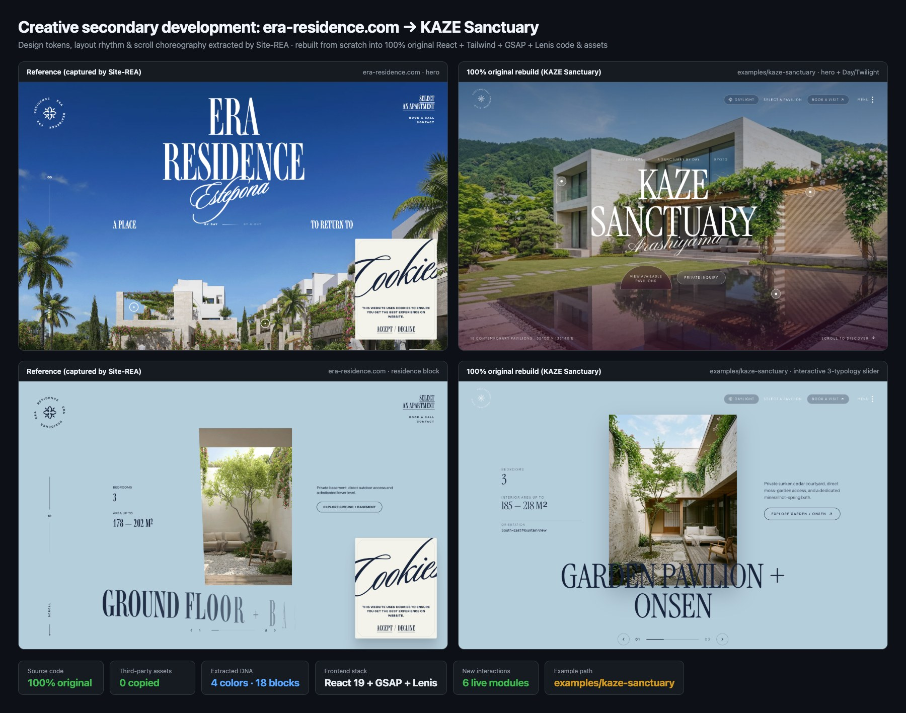
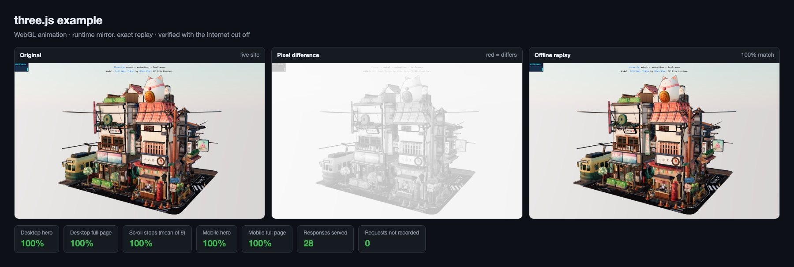
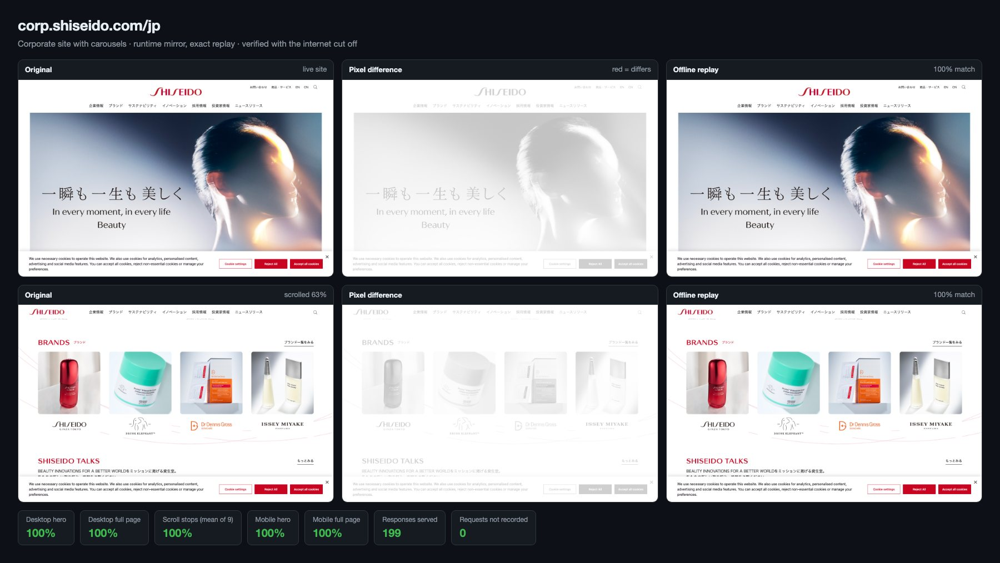
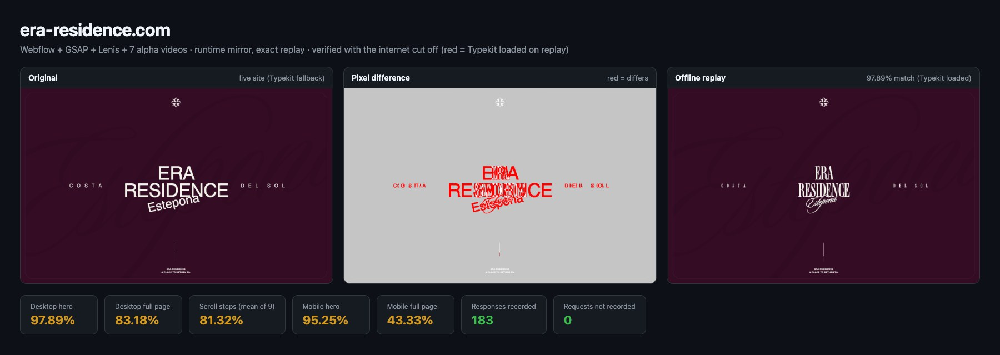
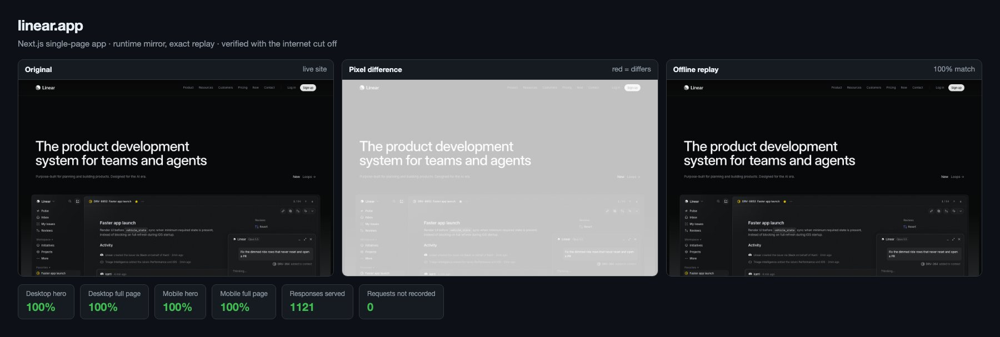
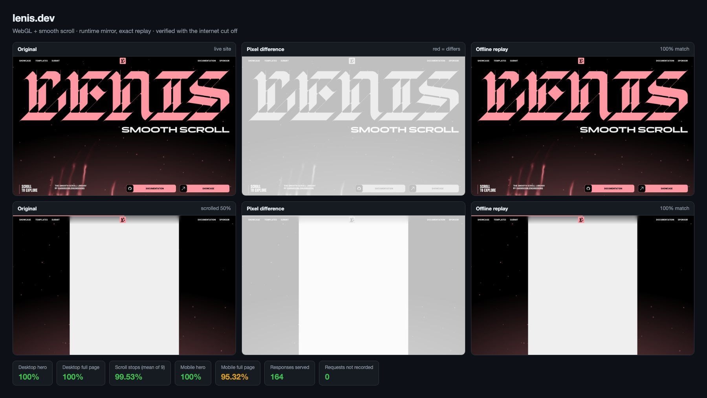
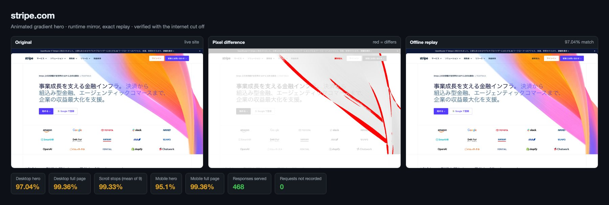
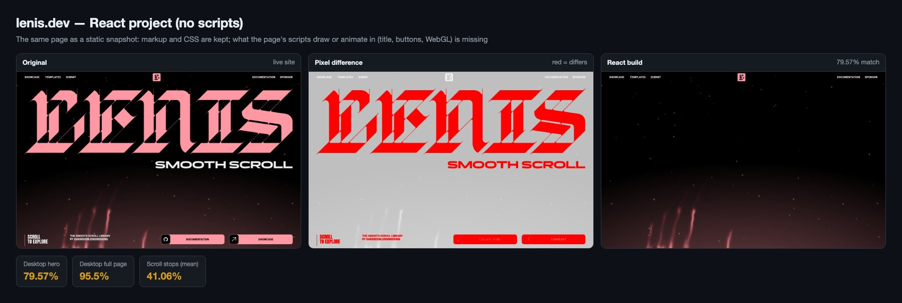

# Site-REA

[English](README.md) | **中文**

把一个网站录下来，在本机离线原样运行；或者转成能接着改的静态 / React 工程；并且断网验收，告诉你和原站差多少。

提供三种用法：MCP 服务器（14 个工具，给 Claude Code / Codex / Cursor / Antigravity 这类 AI 调用）、命令行、Antigravity 插件。

> 下面写的每一项能力都有实测数字。做不到的事单独列在"做不到的事"一节。

---

## 对比案例

每张图都是 `verify` 断网验收的输出：左边是原站，中间是逐像素差异（灰色 = 相同，红色 = 不同），右边是离线回放。图下方的数字是实测相似度。

**创作二次开发案例（`era-residence.com` → [`examples/kaze-sanctuary`](examples/kaze-sanctuary)）** —— 用 Site-REA 提取原站的设计基因（配色令牌 `#340c24` / `#f3f3ec` / `#b5cedb` / `#17233b`、版式节奏与 GSAP + Lenis 滚动编排），从零重写为 **100% 自有源码的 React 19 + Tailwind + GSAP + Lenis 独立网站**：全新品牌（**KAZE Sanctuary · 京都岚山**）、全部重写的文案与原创几何 SVG 徽章、全新生成的 8 张 WebP 视觉素材，并新增 6 项真实交互（昼/夜光影切换、建筑热点标注、3 户型交互滑块 + 户型抽屉、可点击暮色设施切换、室内画廊与预约表单弹窗），零拷贝原站脚本或素材。



**three.js 示例** —— WebGL 场景，离线回放 100%。



**corp.shiseido.com/jp** —— 带随机排序轮播的企业站。首屏和页面中段各一组。



<details>
<summary>更多：era-residence.com、linear.app、lenis.dev、stripe.com，以及静态产物的边界</summary>

**era-residence.com** —— Webflow + GSAP ScrollTrigger + Lenis + 7 段透明通道循环花朵视频（录下 183 个响应、0 缺失）。首屏红色差异来自在线抓取时未加载成功的 Adobe Typekit 字体在离线回放时从缓存正常生效。



**linear.app** —— Next.js 单页应用，录下 588 个响应。



**lenis.dev** —— WebGL 加平滑滚动。



**stripe.com** —— 不到 100%：首屏那块渐变动画每一帧都不一样，红色部分就是它。



**静态产物的边界** —— 同一个 lenis.dev 页面转成不带脚本的 React 工程。标记和样式都在；由页面脚本做动画显示出来的标题、按钮和 WebGL 场景没有。



</details>

截图里是第三方网站，仅用于演示本工具；这些网站及其内容归各自所有者。

## 它能产出什么

| 产出 | 是什么 | 交互 | 适合 |
| :--- | :--- | :--- | :--- |
| **运行时镜像** `runtime-mirror` | 把网站的全部网络响应录下来，原站的 JavaScript 在本机对着录制内容运行 | 和原站一样（3D、动画、单页应用都在跑） | 离线存档、演示、研究一个网站是怎么做的 |
| **静态镜像** `static-mirror` | 把渲染完成的页面冻结成一份 HTML + CSS，不带脚本 | 无 | 留一份页面"标本" |
| **HTML 工程** `vanilla` | 同样的标记，每个区块加了标注，配原站 CSS | 无，需自己写 | 接着改成自己的静态站 |
| **React 工程** `react-vite-tailwind` | 每个区块一个 React 组件（HTML 已转成 JSX），配原站 CSS，Tailwind 可用 | 无，需自己写 | 接着改成自己的 React 站 |
| **滚动播片** `scroll-scrub` | 按滚动位置录下若干帧，用 canvas 随滚动播放 | 无 | 固定在屏幕上的滚动动画段落 |

另外每次抓取都会得到一份**证据目录**：桌面和手机整页截图、分区块截图、配色 / 字体 / CSS 变量、本地化的图片字体等素材、分区块的文案和结构、WebGL / WebGPU 着色器源码、Three.js 场景信息、脱敏后的接口样例。

---

## 实测结果

2026-11-21 用最终代码实测，全部在**断开外网**的条件下验收。数字是和原站截图逐像素对比的相似度。

### 运行时镜像（原站脚本在本机运行）

"精确回放"指 `site-rea open`：地址栏是原网址，录制内容在网络层应答。"本机服务器"指 `node server.mjs` 后打开 `http://127.0.0.1`。

| 网站 | 录到的响应 | 精确回放 · 桌面（首屏 / 整页 / 9 个滚动位置平均） | 精确回放 · 手机（首屏 / 整页） | 本机服务器 · 桌面 | 没录到的请求 |
| :--- | ---: | :--- | :--- | :--- | ---: |
| threejs.org 的 three.js 示例（WebGL 动画） | 15 | 100 / 100 / 100 | 100 / 100 | 100 / 100 / 100 | 0 |
| corp.shiseido.com/jp（传统企业站，轮播 + 同意弹窗） | 99 | 100 / 100 / 100 | 100 / 100 | 94.66 / 98.59 / 93.92 | 0 |
| linear.app（Next.js 单页应用） | 588 | 100 / 100 / 未采样 | 100 / 100 | 100 / 100 / 未采样 | 0 |
| lenis.dev（WebGL + 平滑滚动，页面高 37462px） | 169 | 100 / 100 / 99.53 | 100 / 95.32 | 100 / 99.97 / 100 | 0 |
| stripe.com（动态渐变首屏，683 个请求） | 683 | 97.04 / 99.36 / 99.33 | 95.10 / 99.36 | 99.93 / 99.89 / 99.84 | 0 |
| era-residence.com（Webflow + GSAP + Lenis + 7 段透明视频，高 21908px） | 183 | 97.89 / 83.18 / 81.32 | 95.25 / 43.33 | 97.89 / 83.18 / 79.57 | 0 |

说明：
- 资生堂在"本机服务器"下分数低，是因为它的 Cookie 同意弹窗放在第三方 iframe 里，本机服务器接管不了别的域名的 iframe（被拦下并记了 1 次外网请求）。精确回放没有这个问题。
- Stripe 的脚本会检查自己的域名，在 `127.0.0.1` 上会报 "hostname is not a recognized Stripe host"。精确回放下没有任何错误。首屏不到 100 是因为那块渐变动画每一帧都在变。
- lenis.dev 画面一致，但回放时 Next.js 的预取逻辑多报了一个原站没有的脚本错误（`t[Symbol.asyncIterator] is not a function`），原因没查明，肉眼没看到影响。
- `era-residence.com` 的断网验收 `offline.passed` 为 `true`（0 缺失请求，7 段完整 `.webm`/`.mov` 视频全部入库），但逐像素分数偏低：在线抓取拍基准图时 Adobe Typekit 字体（`ambroise-francois-std`、`sloop-script-three`）连接被拒回退成宽无衬线体，而离线回放时缓存补抓的真实字体即时加载，导致段落更紧凑引发整页纵向偏移（手机端最明显），且本地零延迟让开场拱门遮罩在 63%–100% 滚动位更早打开。
- 结论：**依赖自己域名或嵌了第三方 iframe 的网站，用精确回放；其余两种方式都可以。**

### 静态镜像与 React 工程（不带脚本）

React 工程是真实执行 `npm install && npx vite build` 后对 `dist/` 验收的，和静态镜像的分数相同（同一份标记和样式）。

| 网站 | 桌面（首屏 / 整页 / 滚动平均） | 手机（首屏 / 整页） |
| :--- | :--- | :--- |
| linear.app | 100 / 100 / 未采样 | 100 / 100 |
| three.js 示例 | 100 / 100 / 98.55 | 37.84 / 21.74 |
| corp.shiseido.com/jp | 100 / 97.94 / 94.00 | 43.95 / 18.19 |
| lenis.dev | 79.57 / 95.50 / 41.06 | 83.25 / 81.72 |
| stripe.com | 75.67 / 90.98 / 86.28 | 83.18 / 77.49 |

这组数字说明静态产物的边界：它是**桌面布局在页面顶部那一刻的快照**。靠脚本驱动的东西（滚动后才变化的页头、懒加载的轮播图、WebGL 画面、手机上由脚本重排的结构）不会跟着变。内容以静态排版为主的网站接近 100%，动效重的网站差得多。

### 滚动播片

lenis.dev 录 40 帧：首屏 100，整页 93.28，滚动位置平均 86.48。两帧之间画面是跳的，所以普通长页面效果一般；它只适合"固定在屏幕上、画面随滚动进度变化"的段落。

---

## 安装

需要 Node.js 18 以上。浏览器优先用 Playwright 安装的 Chrome for Testing，找不到才用系统里的 Chrome：

```bash
git clone https://github.com/Zhao73/site-rea.git
cd site-rea
npm install
npx playwright install chromium     # 装一个测试专用浏览器（推荐）
node bin/site-rea.mjs doctor        # 检查环境
```

接到 AI 工具里：

```bash
node bin/site-rea.mjs setup     # 打印 Claude Code / Codex / Cursor 的配置
npm run install:plugin          # 安装为 Antigravity 插件
```

---

## 用法

```bash
# 1. 抓取。页面有动画、轮播、3D、视频时加 --deterministic，验收才有意义
node bin/site-rea.mjs capture https://example.com --out ./work/.site-rea --deterministic

# 2a. 运行时镜像
node bin/site-rea.mjs scaffold ./work/.site-rea ./work/mirror --mode runtime-mirror
node ./work/mirror/server.mjs --port 4175           # 本机服务器，任何浏览器打开 http://127.0.0.1:4175
node bin/site-rea.mjs open ./work/mirror            # 精确回放：弹出浏览器窗口，地址是原网址，不联网（见"做不到的事"里的已知问题）

# 2b. 能改的代码
node bin/site-rea.mjs scaffold ./work/.site-rea ./work/site --mode react-vite-tailwind
cd ./work/site && npm install && npm run build

# 3. 验收（断网）
node bin/site-rea.mjs verify ./work/.site-rea --dir ./work/mirror
node bin/site-rea.mjs verify ./work/.site-rea --dir ./work/site/dist
```

其他命令：`timeline`（按滚动位置采样截图和 3D 轨迹）、`scrub`（录滚动播片的帧）、`ingest`（导入自己保存的 HTML / HAR，全程不联网）、`mock-backend`（由抓到的接口样例生成本地假后端）、`serve`（预览静态目录）。`node bin/site-rea.mjs help` 看全部参数。

### 抓取时做了什么

1. 用桌面（1440×900）和手机（390×844）各打开一次，录下全部网络响应，包括 POST、跳转、Worker 里的请求。
2. 把页面"走一遍"：整页滚动、悬停导航，让懒加载的脚本和图片也被录到。
3. 视频只会被播到的片段录下来，所以另外把完整文件补抓一次。
4. **预演**：断开外网把镜像跑起来，页面还在要、录制里没有的，由服务器补抓；重复到一轮下来不再缺东西。仍然补不到的写在结果的 `runtimeCache.rehearsal.unresolved` 里。

### 验收报告怎么读

- `offline.passed`：产物有没有试图联网、有没有缺文件。`false` 时 `offline.externalRequests` / `offline.misses` 会列出是哪些。
- 运行时镜像的结果在 `replayModes.exact` 和 `replayModes.portable` 里分别给出。
- `heroDiff` / `fullDiff` / `sectionDiffs` / `scrollTimelineDiffs`：首屏、整页、分区块、各滚动位置的相似度。
- 对比图在证据目录的 `verify/` 下，三联排列：原站 | 差异 | 克隆。数字低的时候先看图。
- 原站自己就有的控制台错误不算在克隆头上。

### 确定性模式（`--deterministic`）做了什么

为了让原站和克隆在"同一个状态"下被截图：

- 时间（`Date`、`performance.now`、`requestAnimationFrame`）换成虚拟时钟，起点是抓取那一刻。
- `Math.random` 换成带种子的序列，每个调用位置各有一条，随机排序的内容每次顺序相同。
- 2.4 秒及以上的定时器被暂停：自动轮播停在第一张，延迟弹出的窗口不会出现。
- 截图时 CSS 动画和视频被放到固定状态（有限动画跳到结束，循环动画按虚拟时间定相位，视频停在第一帧）。

它改变了页面的行为，所以默认不开；只在需要逐像素验收时用。

---

## 做不到的事

- **验证码、人机验证、登录墙**：遇到就停，返回 `status: "blocked"`，不做任何绕过。可以自己在浏览器里把页面存成 HTML / SingleFile / HAR，再用 `ingest` 导入。
- **实时连接**：WebSocket 没法从录制回放，镜像里会直接断开（聊天、实时行情这类功能不工作）。
- **抓取时没发生过的请求**：镜像只有录到的内容。没点开过的页面、没触发过的操作、没填过的表单，在镜像里是 404。目前一次只录一个页面。
- **静态镜像 / HTML 工程 / React 工程没有交互**：菜单、轮播、标签页、表单都要自己重写。它们是桌面布局的快照，手机上靠脚本重排的网站对不上（见上面的实测）。
- **React 工程的类名是原站的类名**，不是重新设计过的组件库。Tailwind 以 `tw:` 前缀安装、不带 Preflight，只供新写的部分使用。
- **3D 场景不会被自动重建成源码**。着色器、场景结构、相机轨迹会被抓下来当参考资料，重写要靠人或 AI。想要原样运行，用运行时镜像。
- **本机服务器方式的局限**：页面脚本看到的域名是 `127.0.0.1`，检查域名或写 Cookie 的脚本会报错；第三方 iframe 不在接管范围内。这两类用精确回放。
- **`site-rea open` 的窗口有已知问题**：在作者的机器上（macOS，多个桌面）浏览器启动了、内容也在回放，但窗口没有出现在当前桌面，原因没查明。上表"精确回放"的数字来自 `verify` 的无界面验收，不受影响。想亲眼看效果，先用本机服务器。
- **原站自己的 Service Worker** 在录制和回放时都被停用。
- 以下只在自带的测试页上验证过，没有在真实网站上测：WebGPU（WGSL）着色器抓取、本地假后端、HAR 导入、交互探测。

## 使用边界

把别人的网站原样克隆后公开发布，可能侵犯对方的版权和商标。镜像用于参考、存档，以及迁移你自己或客户自己的网站。

---

## MCP 工具（14 个）

| 工具 | 作用 |
| :--- | :--- |
| `capture_site` | 抓取一个在线网站，生成证据目录和录制内容 |
| `ingest_local_archive` | 导入本地保存的 HTML / HAR，不联网 |
| `capture_scroll_timeline` | 按滚动位置采样截图、着色器变量和 Three.js 相机 / 网格轨迹 |
| `capture_scroll_scrub` | 录滚动播片的帧并生成播放器 |
| `inspect_rich_media` | 查看抓到的 3D / 动效资料 |
| `get_design_tokens` | 读配色、字体、CSS 变量、阴影、圆角、关键帧 |
| `get_section_blueprint` | 读某个区块的结构、文案和截图 |
| `list_assets` | 列出本地化的素材 |
| `discover_routes` | 列出站内链接 |
| `probe_interaction` | 点击 / 悬停 / 填写后截图对比 |
| `scaffold_project` | 生成 5 种产出之一 |
| `scaffold_mock_backend` | 由接口样例生成本地假后端 |
| `verify_clone` | 断网验收并出对比图 |
| `check_environment` | 检查 Node 和浏览器 |

## 测试

```bash
npm test
```

三组：`smoke`（基本流程）、`advanced`（3D、时间轴、播片、假后端、离线导入）、`mirror`（跨域资源、滚动后才加载的脚本、POST、跳转、打印样式表；**把原站服务器关掉以后**，运行时镜像、静态版、HTML 版、React 版仍要和原站 99.5% 以上一致）。这些测试用的是自带测试页；真实网站的结果见上面的实测表。

## License

MIT
